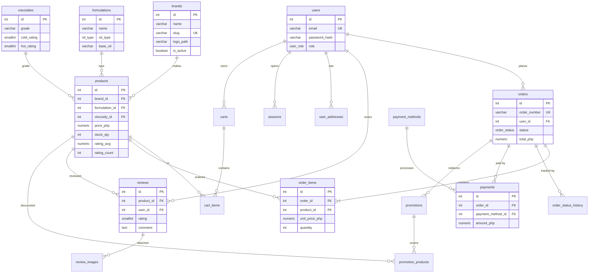

# TorqueLine Database Design

Recommendation for the TorqueLine automotive e-commerce platform.

---

## 1. Database Recommendation: Relational (PostgreSQL)

**Use PostgreSQL (or MySQL 8 as a drop-in alternative — see `mysql/01_schema.sql`).**

The platform is a textbook relational workload. Every one of the four requirement
areas depends on guarantees that only a relational engine provides:

| Requirement | Why relational wins |
|---|---|
| **Order Processing** — "safe transactional tracking" | Checkout must be ACID. Adding an order, its line items, and its payment record has to either fully succeed or fully roll back. A NoSQL store has no multi-document transactions (MongoDB added them later, with heavy caveats — no cross-shard guarantees), so a partial write can leave an order without items. |
| **Product Catalog** — brands, formulations, viscosities, pricing, stock | These are fixed, highly relational attributes. A product row *references* a brand, a formulation and a viscosity. Enforcing that with a Foreign Key is free in SQL; in MongoDB you must validate in application code and accept denormalization drift. |
| **User Management** — registration, logins, profiles | `UNIQUE` on email, cascading deletes (delete user → cascade addresses, sessions), and referential integrity on orders are native constraints, not application conventions. |
| **Social Proof** — reviews + dynamic star ratings | The headline figure ("4.9/5 from 2,847+ reviews") is an `AVG()` and `COUNT()` over a review table joined to products. That is a single aggregate query. Doing this in MongoDB means either a `$group` aggregation pipeline on every read or maintaining counters manually — and the manual version drifts from reality. |
| **Promotional discounts** | "10% off" banners must apply to *specific products*, be date-windowed, and be redeemable a limited number of times. A `promotion_products` join table plus a `CHECK (usage_count < max_redemptions)` is the natural model. |

### Why *not* NoSQL

The only serious argument for MongoDB here would be the product catalog's
variability (motor oil SKUs have many optional attributes). That is a weak
argument, because the requirement list names a **fixed, known** set of
attributes — brands, formulations, viscosities, price, image, stock — which is
exactly the shape SQL was designed for. If the catalog ever becomes truly
open-ended, add a `jsonb` attributes column *to Postgres* rather than moving
the whole system to a document store.

### Why PostgreSQL specifically over MySQL

- `NUMERIC(10,2)` for money (both have it, but Postgres enforces it strictly)
- `GENERATED ALWAYS AS ... STORED` for denormalized rating aggregates
- Richer `CHECK` constraints, partial indexes, and `JSONB`
- `IDENTITY` columns, better concurrent index builds

**Pick MySQL instead if** you are deploying to PHP shared hosting (common in
the Philippines) or already run MySQL operationally. `mysql/01_schema.sql` is a
direct port of the same design — same tables, same columns, same relationships.

### Data modelling rules for this schema

1. **Money is never `FLOAT`.** All peso amounts are `NUMERIC(10,2)`. Floating
   point cannot represent 0.10 exactly and will drift on totals.
2. **Orders snapshot their data.** `order_items` copies `product_name`,
   `unit_price_php` and the image at purchase time. Renaming a product or
   changing its price tomorrow must never rewrite historical invoices.
3. **Passwords are hashed.** `users.password_hash` stores a bcrypt/Argon2
   digest, never a password. The current front-end `localStorage` approach is
   a UI demo only and must be replaced by server-side sessions.
4. **Sessions are server-side.** `sessions` stores a *hash* of the session
   token; the raw token lives only in the user's cookie.

---

## 2. Schema Design

### Entity relationships



### Table reference

**Catalog**

| Table | Key fields | Notes |
|---|---|---|
| `brands` | `id` PK, `name` UNIQUE, `slug` UNIQUE, `logo_path`, `country`, `is_active`, timestamps | Castrol, TorqueLine, Mobil 1, Shell Helix… |
| `formulations` | `id` PK, `name` UNIQUE, `oil_type` ENUM(`synthetic`,`semi_synthetic`,`mineral`,`blend`), `base_oil`, `description` | "synthetic vs mineral" from the brief |
| `viscosities` | `id` PK, `grade` UNIQUE (`15W-40`), `cold_rating`, `hot_rating`, `viscosity_index`, `sort_order` | Split into cold/hot rating so sorting is numeric, not lexical (`15W-40` vs `5W-30`) |
| `products` | `id` PK, `brand_id` FK→`brands`, `formulation_id` FK→`formulations`, `viscosity_id` FK→`viscosities`, `sku` UNIQUE, `name`, `slug` UNIQUE, `volume_liters`, `api_spec`, `price_php` NUMERIC(10,2), `compare_at_price_php`, `image_path`, `stock_qty`, `low_stock_threshold`, `is_active`, `rating_avg` NUMERIC(3,2), `rating_count`, `attributes` JSONB, timestamps | The SKU. Holds price in ₱ and stock |
| `promotions` | `id` PK, `name`, `code` UNIQUE, `discount_type` ENUM(`percent`,`fixed`), `discount_value`, `starts_at`, `ends_at`, `min_order_php`, `max_redemptions`, `usage_count`, `banner_image`, `is_active` | "10% off" banners |
| `promotion_products` | `promotion_id` PK/FK, `product_id` PK/FK | Which SKUs a promo covers (composite PK) |

**Identity**

| Table | Key fields | Notes |
|---|---|---|
| `users` | `id` PK, `name`, `email` UNIQUE, `password_hash`, `phone`, `role` ENUM(`client`,`admin`,`distributor`), `avatar_url`, `is_active`, `email_verified_at`, `last_login_at`, timestamps | `password_hash` = bcrypt/Argon2 |
| `user_addresses` | `id` PK, `user_id` FK→`users` ON DELETE CASCADE, `recipient_name`, `phone`, `region`, `province`, `city`, `barangay`, `street`, `postal_code`, `is_default` | PH address hierarchy |
| `sessions` | `id` PK, `user_id` FK→`users` ON DELETE CASCADE, `token_hash` UNIQUE, `ip_address`, `user_agent`, `expires_at`, `created_at` | Server-side session; only the hash is stored |

**Commerce**

| Table | Key fields | Notes |
|---|---|---|
| `carts` | `id` PK, `user_id` FK NULL (guest carts use `session_token`), `session_token` UNIQUE, timestamps | |
| `cart_items` | `id` PK, `cart_id` FK ON DELETE CASCADE, `product_id` FK, `quantity`, `unit_price_php`, `added_at`, UNIQUE(`cart_id`,`product_id`) | `unit_price_php` snapshots the price shown in the cart |
| `orders` | `id` PK, `order_number` UNIQUE, `user_id` FK NULL, `status` ENUM, `payment_status` ENUM, `payment_method_id` FK, `subtotal_php`, `shipping_php`, `discount_php`, `tax_php`, `total_php`, `promotion_id` FK NULL, `shipping_address` JSONB, `billing_address` JSONB, `notes`, `placed_at`, `paid_at`, `shipped_at`, `delivered_at`, `cancelled_at`, timestamps | Header + money totals |
| `order_items` | `id` PK, `order_id` FK ON DELETE CASCADE, `product_id` FK SET NULL, `product_name`, `sku`, `unit_price_php`, `quantity`, `line_total_php`, `image_path` | Snapshot columns |
| `order_status_history` | `id` PK, `order_id` FK ON DELETE CASCADE, `from_status`, `to_status`, `note`, `changed_by` FK→`users` SET NULL, `created_at` | Full audit trail |
| `payment_methods` | `id` PK, `code` UNIQUE (`gcash`), `name`, `provider`, `logo_path`, `requires_reference`, `is_active`, `sort_order` | GCash, Maya, ShopeePay, card, bank transfer, COD |
| `payments` | `id` PK, `order_id` FK, `payment_method_id` FK, `provider_reference`, `amount_php`, `status` ENUM, `amount_refunded_php`, `paid_at`, `payload` JSONB, timestamps | One row per payment attempt |

**Social proof**

| Table | Key fields | Notes |
|---|---|---|
| `reviews` | `id` PK, `product_id` FK ON DELETE CASCADE, `user_id` FK ON DELETE CASCADE, `order_item_id` FK SET NULL, `rating` SMALLINT CHECK 1–5, `title`, `comment`, `status` ENUM(`pending`,`approved`,`rejected`), `is_verified_purchase`, timestamps | |
| `review_images` | `id` PK, `review_id` FK ON DELETE CASCADE, `image_path`, `sort_order` | Customer photos |

### Relationship summary

- **PK:** every table has `id BIGINT GENERATED ALWAYS AS IDENTITY`; join tables use composite PKs (`promotion_products`, `order_status_history`).
- **FK:** `products.brand_id → brands.id`, `products.formulation_id → formulations.id`, `products.viscosity_id → viscosities.id`, `orders.user_id → users.id`, `order_items.order_id → orders.id`, `order_items.product_id → products.id`, `reviews.product_id → products.id`, `reviews.user_id → users.id`, `payments.order_id → orders.id`, `promotion_products.* → promotions.id / products.id`.
- **Delete rules:** `CASCADE` for owned children (cart items, reviews, sessions, order items, addresses); `SET NULL` for historical references (`order_items.product_id` — a deleted SKU must not erase past orders).

---

## 3. Files

| File | Purpose |
|---|---|
| `schema.sql` | PostgreSQL DDL: extensions, enums, tables, indexes, triggers, views |
| `seed.sql` | Reference data: brands, formulations, viscosities, payment methods, products, admin user |
| `mysql/01_schema.sql` | MySQL 8 port of the same design |
| `mysql/02_seed.sql` | MySQL seed data |

### Run it

```bash
# PostgreSQL
createdb torqueline
psql torqueline -f db/schema.sql
psql torqueline -f db/seed.sql

# MySQL
mysql -u root -p -e "CREATE DATABASE torqueline CHARACTER SET utf8mb4 COLLATE utf8mb4_unicode_ci;"
mysql -u root -p torqueline < db/mysql/01_schema.sql
mysql -u root -p torqueline < db/mysql/02_seed.sql
```

### Mapping the current front-end to this schema

The live site is a static demo using `localStorage`. When the backend lands, the
keys map directly:

| `localStorage` key | New table |
|---|---|
| `torqueline_users` | `users` (password → `password_hash` via bcrypt) |
| `torqueline_session` | `sessions` (token → `token_hash`, raw token in an HttpOnly cookie) |
| `torqueline_orders` | `orders` + `order_items` + `payments` (the JSON blob becomes three rows) |
| `torqueline_cart` | `carts` + `cart_items` |
| Product definitions in `index.html` | `products` + `brands` + `formulations` + `viscosities` |
| Hardcoded testimonials | `reviews` (seeded, then real customer rows) |
